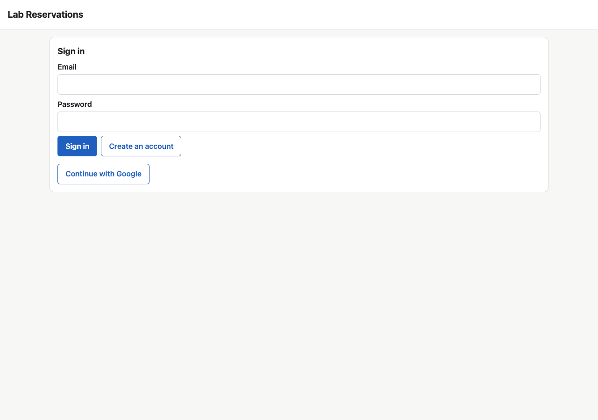
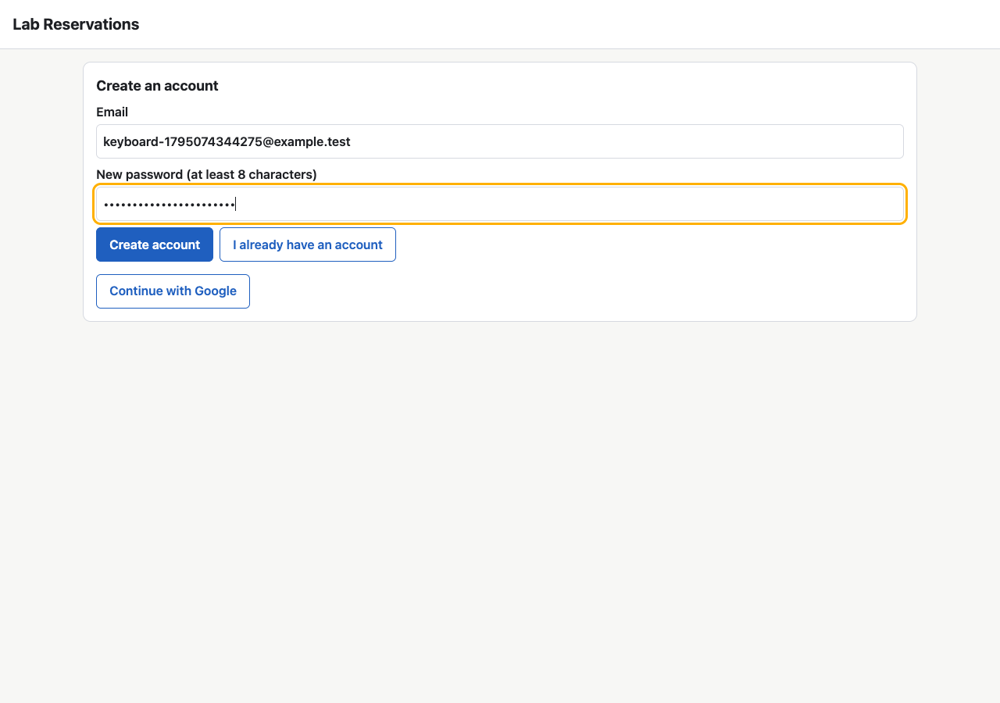
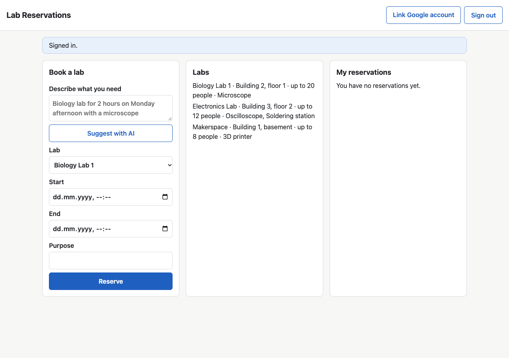
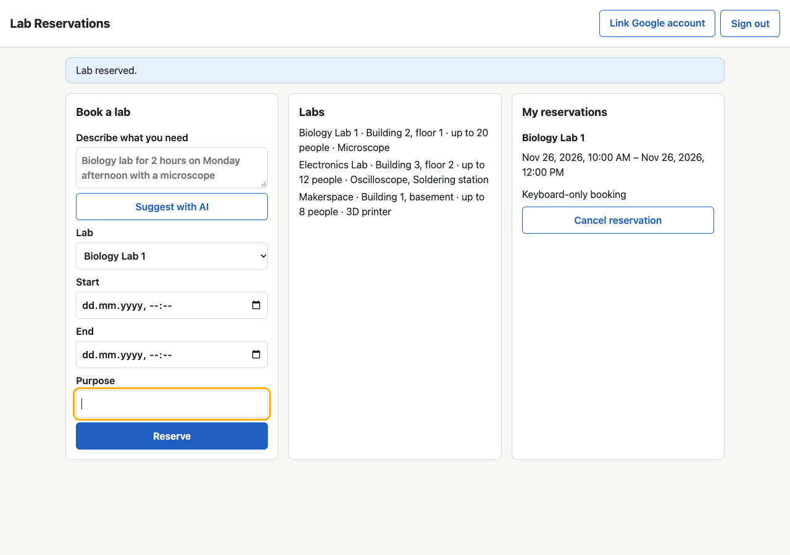
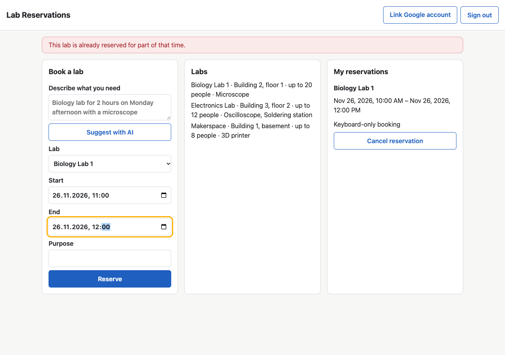
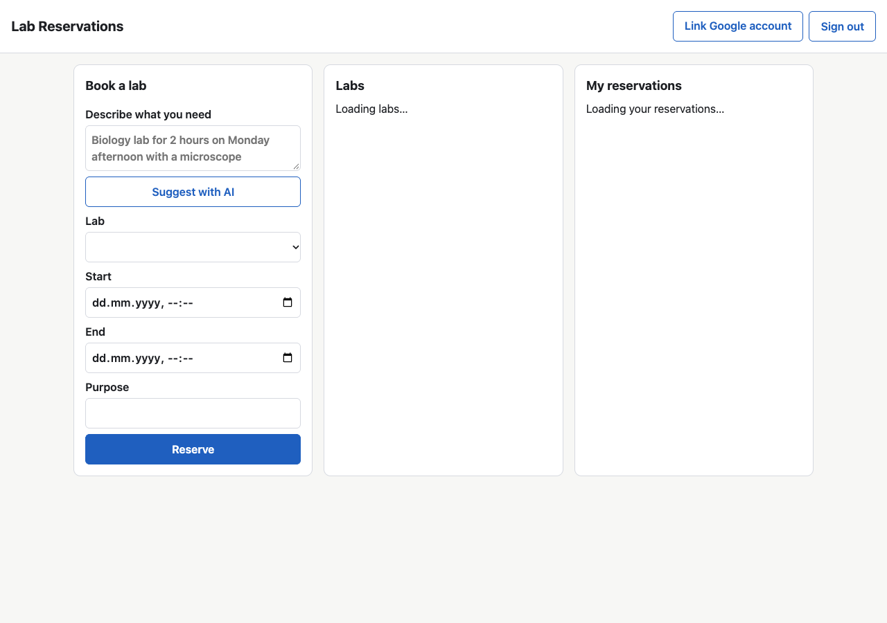
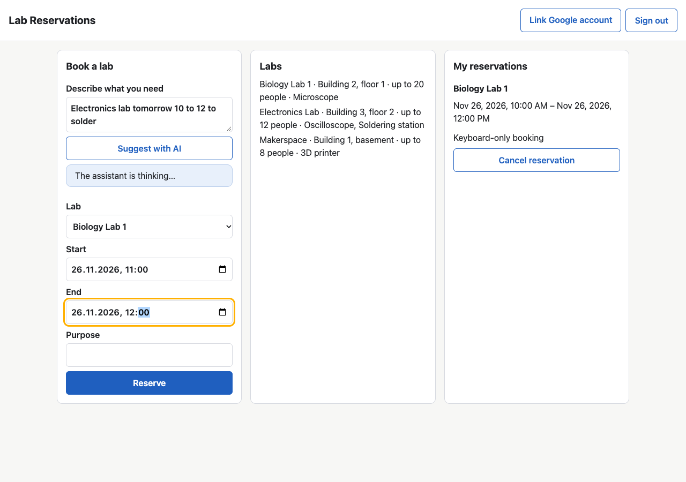
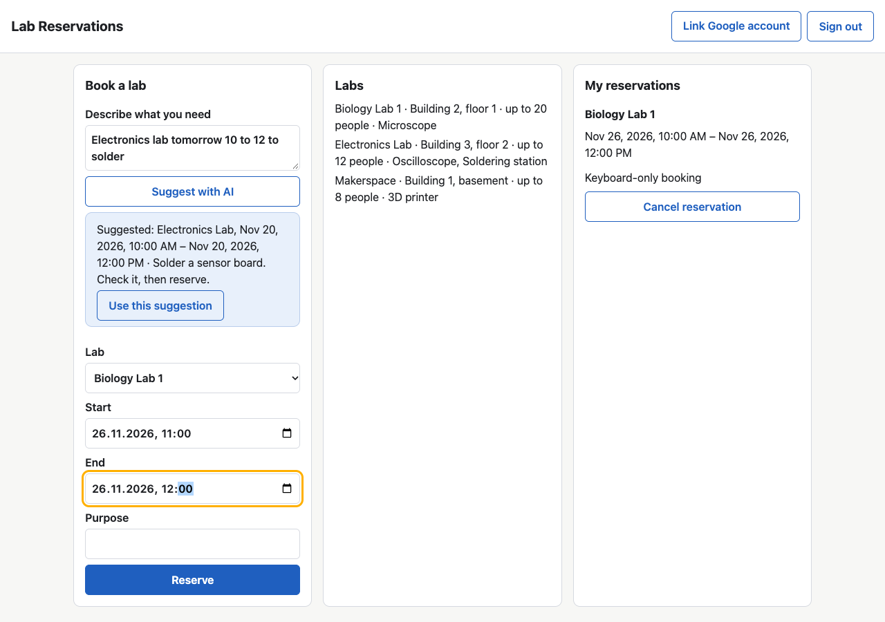
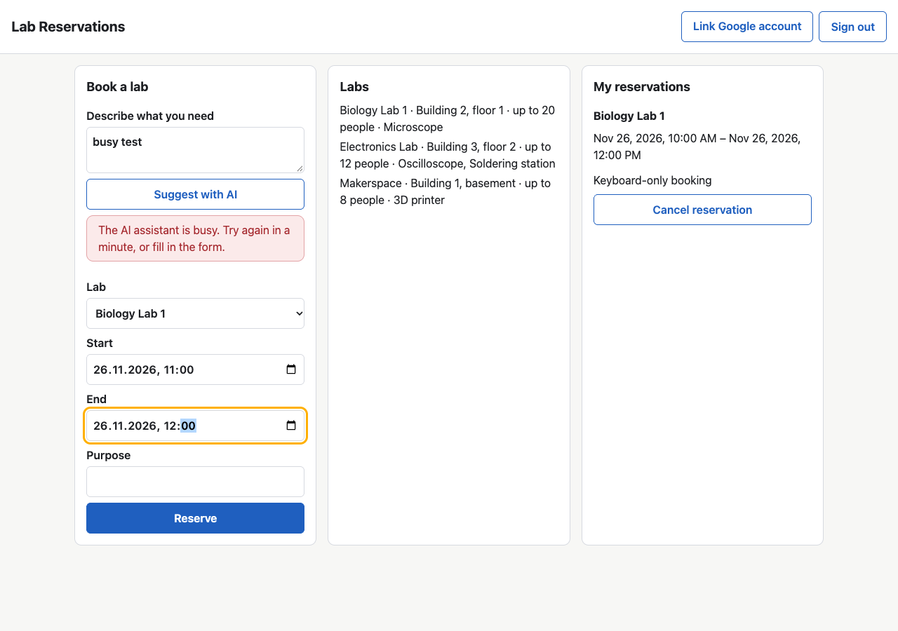
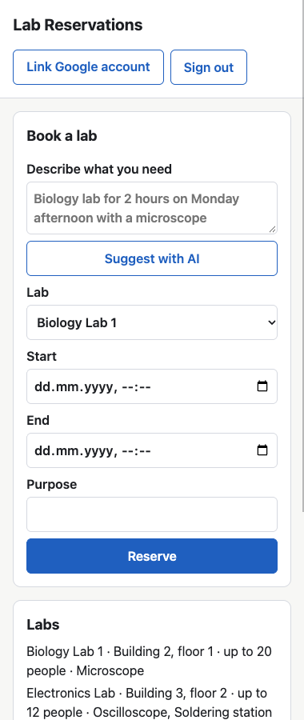

# UI checklist

<!-- Exercise 4 hands this in. Tick an item only when you have checked it, and replace
     the "how I checked" line with what you actually did. An unticked box is not a
     failure: it is a gap you then write into READINESS.md. A ticked box you cannot
     demonstrate at the defence is worse than an unticked one. -->

"Modern" is not a style. It is a short list of things a user notices when they are
missing: the screen tells you what is happening, you can get through it with a keyboard,
the text is readable, and nothing jumps around while it loads.

Checked in the built-in browser against the app on `http://localhost:3100` with a local
Postgres 16, on 2026-10-28. Viewports were set with the browser tool; no real phone was used.
The three items left open then were checked on 2026-11-19 in headless Chrome, driven over the
DevTools protocol by a script, against the same local setup (see "Evidence" below).

## Layout and typography

- [x] **One spacing scale and one type scale.** Sizes come from a small set of design tokens, not from numbers typed where they were needed.
  - how I checked: colours, spacing, radius and font sizes are tokens in `:root` (`public/styles.css`). The font sizes were literals until this check; they are now `--font-size-lg` and `--font-size-xl`. Literals still left: 1px borders, the 1100px content width, the 768px and 1280px breakpoints, and the 3px focus outline.
- [x] **Responsive at 380, 768 and 1280 pixels wide.** No horizontal scrollbar, no text running under another element.
  - how I checked: `document.documentElement.scrollWidth` equalled the viewport width at 380, 768 and 1280 px. The 380 px layout is one column and the 768 px layout is two. I looked at screenshots at 380 and 768 px and saw no text overlapping another element; 1280 px was measured but not looked at closely.
- [x] **Nothing jumps while the page loads.** Images and cards reserve their space before their content arrives.
  - how I checked: a `PerformanceObserver` for `layout-shift` entries, installed before the page's own script, summed the shifts of a signed-in page load until "My reservations" had filled in. Cumulative layout shift was 0 with every request delayed by 2.5 s. Without the delay it was 0 at 380 and 1280 px, and 0 in one run and 0.0025 in another at 768 px; the usual "good" limit is 0.1. The lists fill in below their headings and the cards grow downwards, so nothing above them moves. Headless Chrome only; no real phone.

## The four states, on every screen

A screen that only handles "it worked" is a screen that lies to the user on the day it matters.

- [x] **Loading.** Something tells the user the app is working, within about 100 ms.
  - how I checked: with the network slowed by 2.5 s in the browser, the page showed "Loading labs…" and "Loading your reservations…" while the requests were pending. I did not measure the 100 ms figure, and I did not capture this as a screenshot.
- [x] **Empty.** The screen says what this list is for and what to do next, instead of showing nothing.
  - how I checked: a new account shows "You have no reservations yet." under "My reservations". The labs list is never empty in the seed data, so its empty text ("No labs have been added yet.") is only in the code.
- [x] **Error.** A sentence a person can read. Never a raw JSON body, never a stack trace, never just "Error".
  - how I checked: a booking that overlaps an existing one shows "This lab is already reserved for part of that time." The assistant with no API key shows "The AI assistant is not set up right now. Please fill in the form instead." Neither showed a raw body.
- [x] **Success.** The user can see that what they did took effect, without reloading the page to find out.
  - how I checked: after booking, "Lab reserved." appeared and the booking was in "My reservations" with its times and purpose, with no reload.

## Keyboard and accessibility

- [x] **The main flow works with the keyboard alone.** Sign in, do the core action, sign out, without touching the mouse.
  - how I checked: on 2026-10-28, sign-in and sign-out by keyboard in the built-in browser. On 2026-11-19 the whole flow by key events only (no clicks), in headless Chrome: Tab through "Skip to content", email, password, "Sign in" to "Create an account", Enter (focus moves to the email field), type the email, Tab, type the password, Enter. Then Tab through the assistant box to Lab, Tab to Start, type the date, Tab inside the field to the time, type it, Tab to End, the same, Tab to Purpose, type, Enter: "Lab reserved." and the booking in "My reservations". The same keys for a clashing slot showed the error sentence. Then Tab to "Sign out", Enter: focus lands on the "Sign in" heading. Not tried with a screen reader.
  - found on the way: a mistyped five-digit year in the date field showed "Invalid time value", the browser's own error. The form now says "Start and end must be valid dates and times." (`public/app.js`, `toIso`).
- [x] **The focused element is visible.** A `:focus-visible` outline that is not switched off.
  - how I checked: the focused select had a computed `outline: solid 3px rgb(255, 176, 0)`, from `:focus-visible` in `styles.css`.
- [x] **Text contrast is at least 4.5:1.** Name the tool you measured with.
  - tool: no contrast-checker app. I wrote a short JavaScript snippet, run in the built-in browser's page, that reads each element's computed colour and background (`getComputedStyle`) and applies the WCAG 2.x relative-luminance formula: ratio = (L1 + 0.05) / (L2 + 0.05). I did not check with axe, Lighthouse or a colour picker, so an independent tool may give slightly different figures.
  - how I checked: computed colours from the browser, with the WCAG relative-luminance formula run in page script: body text 15.39:1, notice 14.37:1, error notice 6.24:1, primary button 6.09:1, ghost button 6.09:1. Placeholder text was not measured.
- [x] **Every input has a label** a screen reader reads, not just placeholder text.
  - how I checked: in the page, each of the seven form fields (email, password, description, lab, start, end, purpose) has an associated `<label>`.
- [x] **The page has a correct `<title>` and `lang`.**
  - how I checked: `lang="en"` and `<title>Lab Reservations</title>`, read from the page.
- [x] **Touch targets are at least 44 pixels.**
  - how I checked: first measurement at 380 px found buttons and inputs at 42 px and the lab select at 39 px. Added `--target-min: 2.75rem` to them. Re-measured at 380 px: no control under 44 px.

## The model feature

- [x] **It shows that it is thinking.** A model call is slow and a free service may have been asleep; a frozen button is the worst possible answer.
  - how I checked: "The assistant is thinking…" appeared immediately after pressing "Suggest with AI".
- [x] **It shows when it failed,** and the rest of the screen still works.
  - how I checked: with no API key the box shows "The AI assistant is not set up right now. Please fill in the form instead." Afterwards sign-out, keyboard sign-in and the reservation list still worked. On 2026-11-19 the 429 message, "The AI assistant is busy. Try again in a minute, or fill in the form.", was seen on screen from the local stand-in (`docs/ui/08-assistant-failed.png`). The timeout message is not seen on screen; it is covered by tests (AC-17).
- [x] **The user can tell the model's suggestion from a fact.** It is labelled as a suggestion, not presented as data the app knows.
  - how I checked: on screen, with a local stand-in for Gemini (`scripts/fake-gemini.mjs`, loaded with `node --import`, which answers requests to the Gemini address with a fixed booking after 1.5 s). The answer goes through the same adapter, schema and checks as a real one. The box reads "Suggested: Electronics Lab, … Check it, then reserve." with a "Use this suggestion" button, in the blue notice style, apart from "My reservations"; the booking form is not filled until the button is pressed (`docs/ui/07-assistant-suggestion.png`). On 2026-11-19 also seen on the live site with a real answer (from `gemini-3.1-flash-lite`, through the fallback), 4.2 s after pressing the button, with the same label and button.

## Decisions

- [x] **Dark mode, or a written decision not to have one.**
  - what I decided and why: no dark mode. The app has one palette, and I checked its contrast in light mode only. A dark palette would need its own contrast measurements, which I have not done. The assistant wrote this decision for the project; change it if you disagree.

## Evidence

<!-- Screenshots of at least the four states of one screen, and of the model feature
     thinking and failing. A link to them is enough; they do not have to be in the repo. -->

Screenshots of the reservations screen and the assistant box, taken on 2026-11-19 in headless Chrome at 1280 × 900 (and 380 px wide for the last one), against the local app and a local Postgres 16. The assistant's answers come from the local stand-in described above, not from Gemini.

| State | Screenshot |
|---|---|
| Sign-in screen |  |
| Create an account (separate form, new password) |  |
| Empty: a new account |  |
| Success: "Lab reserved." and the booking in the list |  |
| Error: a clashing booking |  |
| Loading: requests delayed by 2.5 s |  |
| Assistant thinking |  |
| Assistant suggestion, labelled |  |
| Assistant failed (a 429 from the stand-in) |  |
| Main screen at 380 px |  |

The script that drove Chrome is `scripts/ui-check.mjs`, and the Gemini stand-in is `scripts/fake-gemini.mjs`; the first lines of the script say how to run them again. It was run twice, and both runs passed every step.
